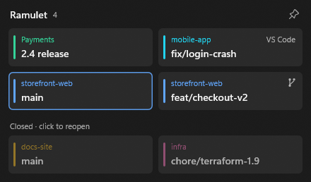
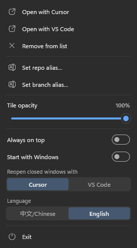

# Ramulet

English | [简体中文](README.zh-CN.md)


A desktop tile for Windows that shows every open Cursor / VS Code window as **repo + branch**. Click a tile to jump to that window. Close the windows you don't need to free memory; they stay on the tile, greyed out, and come back with one click.

<p align="center">
  
</p>

- **One tile per editor window:** repo name on top, current branch below. Windows of the same repo sit together and share a color. The window you used last has an outline.
- **Worktrees:** a Git worktree shows its main repo's name with a small fork icon, so every checkout of a repo reads as that repo on its own branch.
- **Closed windows:** when you close an editor window, its folder stays below, greyed out. Click it to reopen the folder in Cursor or VS Code.
- **Aliases:** give a repo or a branch your own name. A repo alias applies to all of that repo's tiles.
- **Always current:** updates as soon as editor windows open, close or switch files; a branch switched in a terminal shows up within 2 seconds.
- **Light:** a single ~500 KB exe, about 7 MB of memory, close to 0% CPU when idle. No editor extension, no editor settings changed, no git process started.
- English and Chinese interface.

## Install

Download `Ramulet-Setup-<version>.exe` from [Releases](https://github.com/ArthurLauCS/Ramulet/releases/latest) and run it. Requires 64-bit Windows 10 or 11; Windows 11 is recommended (rounded corners and shadows).

- The installer is not signed with a commercial code-signing certificate, so Windows may show "Windows protected your PC". Click **More info** → **Run anyway**.
- It installs for the current user only and does not ask for administrator permission.
- The language you pick in setup becomes the interface language. You can change it later from the menu.

## Using it

- **Where it sits:** on the desktop, below all other windows. It has no taskbar button; its entry is the tray icon.
- **Bring to front:** left-click the tray icon, pinned or not. It goes back to the desktop as soon as you switch to another program, including by clicking a tile.
- **Always on top:** the pin in the upper-right corner.
- **Move / width:** drag the tile to move it; drag its left or right edge to change the width. More columns appear when it is wider; the height follows the number of windows.
- **Reopen a closed window:** click its greyed tile. The first time, you choose Cursor or VS Code, and that becomes the default (change it in the menu under **Reopen closed windows with**). Right-click a closed tile to open it with the other editor once, or to remove it from the list. The 30 most recently closed folders are kept, also across restarts.
- **Aliases:** right-click a tile → **Set repo alias…** / **Set branch alias…**. Enter or clicking elsewhere saves, Esc cancels, an empty name restores the original. A branch alias belongs to that repo, so `develop` can have a different alias in each repo.
- **Menu:** right-click the tile or the tray icon. Opacity (20–100%), always on top, start with Windows, the editor for reopening, language, exit.

<p align="center">
  
</p>

## How it works

Ramulet reads the editor windows' titles (`file - folder - Cursor`), looks the folder up in the editor's own `%APPDATA%\<Cursor|Code>\User\globalStorage\storage.json`, and reads `.git/HEAD` directly. Window changes arrive through system window events, so nothing is polled except a 2-second check for branch switches. Remote windows (SSH / WSL) show their folder name without a branch. Settings, aliases and the closed list are kept in `%APPDATA%\Ramulet\config.txt`.

## Build

Requires Rust (stable) on 64-bit Windows 10 or 11.

```bash
cargo build --release
```

The exe is `target/release/ramulet.exe`.

- `cargo test` runs the unit tests.
- `ramulet.exe --dump out.txt` writes the detected windows and the scan time without opening a window.
- `ramulet.exe --demo --data <empty folder>` shows made-up repos (used for the screenshots).
- `powershell -File scripts/installer.ps1` builds the installer into `target/installer` (needs [Inno Setup 6](https://jrsoftware.org/isinfo.php)).
- To change the icon, edit `assets/icon.svg` / `assets/icon-small.svg` and run `powershell -File scripts/icon.ps1` (needs Chrome and the Windows SDK's rc.exe).

## License

[MIT](LICENSE)
