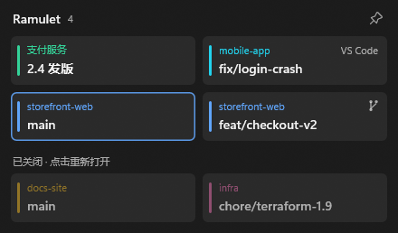
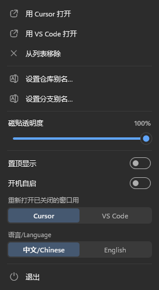

# Ramulet

[English](README.md) | 简体中文


Windows 桌面磁贴：把每个打开的 Cursor / VS Code 窗口显示成 **仓库名 + 分支名**，点一下切到那个窗口。用不到的窗口可以关掉省内存，它会置灰留在磁贴上，要用时点一下就回来。

<p align="center">
  
</p>

- **每个编辑器窗口一块磁贴：** 上行仓库名，下行当前分支。同一仓库的窗口排在一起、同一个颜色；最近用过的那个描一圈边。
- **工作树：** Git 工作树显示主仓库的名字和一个小分叉图标，同一仓库的几个检出一眼就能对上号。
- **已关闭的窗口：** 关掉编辑器窗口后，它的文件夹置灰留在下面，点一下用 Cursor 或 VS Code 重新打开。
- **别名：** 仓库和分支都可以起自己的名字，仓库别名对这个仓库的所有磁贴生效。
- **实时：** 编辑器窗口开关、切换文件时立刻更新；在终端里切分支，2 秒内跟上。
- **轻量：** 单个约 500 KB 的 exe，内存约 7 MB，空闲时 CPU 接近 0%。不用装编辑器插件，不改编辑器设置，不起 git 进程。
- 中英文界面。

## 安装

从 [Releases](https://github.com/ArthurLauCS/Ramulet/releases/latest) 下载 `Ramulet-Setup-<版本>.exe` 运行即可。需要 64 位 Windows 10 或 11，推荐 Windows 11（有圆角和阴影）。

- 安装包没有商业代码签名，Windows 可能提示“Windows 已保护你的电脑”：点“更多信息”→“仍要运行”。
- 只为当前用户安装，不需要管理员权限。
- 安装时选的语言就是界面语言，之后可以在菜单里改。

## 使用

- **位置：** 贴在桌面上，在所有窗口下面。不占任务栏按钮，入口是托盘图标。
- **叫到前面：** 左键点托盘图标，置不置顶都行。切到别的程序（包括点磁贴切到编辑器）后自动回到桌面。
- **置顶：** 右上角的图钉。
- **移动 / 宽度：** 拖动磁贴移动；拖左右边改宽度，宽了自动多排几列；高度跟着窗口数走。
- **重新打开已关闭的窗口：** 点它的灰色磁贴。第一次点时选 Cursor 还是 VS Code，选的就成为默认（菜单里“重新打开已关闭的窗口用”可以改）。右键已关闭的磁贴可以临时用另一个编辑器打开，或从列表移除。保留最近关闭的 30 个文件夹，重启后还在。
- **别名：** 右键磁贴 →“设置仓库别名…”/“设置分支别名…”。回车或点到别处保存，Esc 取消，清空后保存恢复原名。分支别名按仓库分开，每个仓库的 `develop` 可以各起各的名字。
- **菜单：** 右键磁贴或托盘图标。透明度（20%～100%）、置顶、开机自启、重新打开用的编辑器、语言、退出。

<p align="center">
  
</p>

## 原理

读编辑器窗口的标题（`文件 - 文件夹 - Cursor`），在编辑器自己的 `%APPDATA%\<Cursor|Code>\User\globalStorage\storage.json` 里查到文件夹的完整路径，直接读 `.git/HEAD`。窗口变化靠系统窗口事件通知，除了每 2 秒看一次分支有没有切，不做轮询。远程窗口（SSH / WSL）只显示文件夹名，没有分支。设置、别名和已关闭列表存在 `%APPDATA%\Ramulet\config.txt`。

## 构建

需要 Rust（stable），64 位 Windows 10 或 11。

```bash
cargo build --release
```

exe 在 `target/release/ramulet.exe`。

- `cargo test` 跑单元测试。
- `ramulet.exe --dump out.txt` 不开窗口，把扫到的窗口和扫描耗时写到文件。
- `ramulet.exe --demo --data <空文件夹>` 显示一组虚构的仓库（截图用）。
- `powershell -File scripts/installer.ps1` 打安装包到 `target/installer`（需要 [Inno Setup 6](https://jrsoftware.org/isinfo.php)）。
- 改图标：编辑 `assets/icon.svg` / `assets/icon-small.svg`，运行 `powershell -File scripts/icon.ps1`（需要 Chrome 和 Windows SDK 的 rc.exe）。

## 许可

[MIT](LICENSE)
